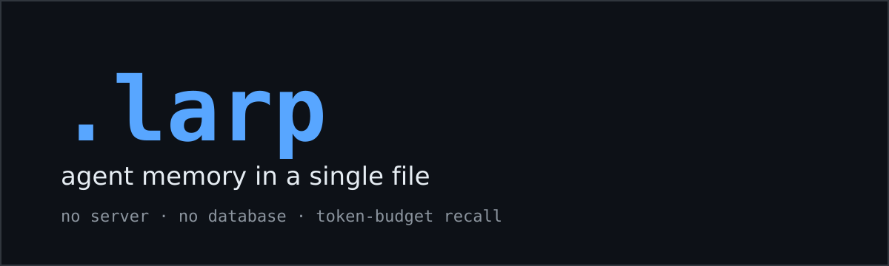
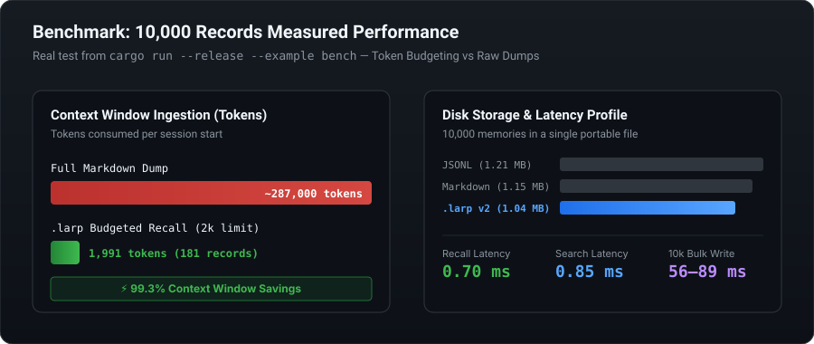

<p align="center">
  <picture>
    <source media="(prefers-color-scheme: dark)" srcset="assets/banner.svg">
    <source media="(prefers-color-scheme: light)" srcset="assets/banner.svg">
    
  </picture>
</p>

<p align="center">
  <a href="https://github.com/pal404error/larp-files/actions/workflows/tests.yml"></a>
  <a href="https://github.com/pal404error/larp-files/actions/workflows/benchmarks.yml"></a>
  <a href="https://crates.io/crates/larp-memory"></a>
  <a href="LICENSE"></a>
  
  
</p>

<p align="center">
  <strong>Single-file memory format for AI agents.</strong><br>
  Small on disk, cheap to recall, searchable, versioned, and crash-safe.
</p>

---

## The Problem

Agents today store long-term memory in one of two extremes:
1. **Flat Markdown / JSON files:** The agent re-reads the entire file at the start of every session. As history grows, token consumption and API costs skyrocket.
2. **Vector Databases:** Require background daemon processes, Docker containers, external embedding models, and ongoing operational maintenance.

## The Solution: `.larp`

`.larp` is the local-first file format in between. One portable file with:
- **Append-only CRC-checked frames** with zstd compression (v2).
- **Audit preservation:** Corrections supersede older entries without rewriting history.
- **Budgeted Recall:** Returns the highest-scoring memories that fit strictly inside your token budget, saving up to **99.3% in token overhead**.
- **Native MCP Server:** Plug directly into Claude Code, Cursor, VS Code Copilot, or Codex via stdio.

---

## 60-Second Install

```bash
# Linux / macOS (installs the latest release binary)
curl -fsSL https://raw.githubusercontent.com/pal404error/larp-files/main/install.sh | sh

# Windows (PowerShell)
irm https://raw.githubusercontent.com/pal404error/larp-files/main/install.ps1 | iex

# Or install from source with Cargo
cargo install --path .
```

*(Once published on crates.io: `cargo install larp-memory`)*

---

## Quickstart

Run real commands right away (defaults to `memory.larp` in the current directory, or use `--file <path>`):

```bash
# 1. Store memories
larp append --type fact --salience 0.9 "the user prefers rust"
larp append --type preference "likes short answers"
larp append --type episode "configured production deployment"

# 2. Recall only what fits your token budget (scored by relevance & recency)
larp recall --max-tokens 2000 rust

# 3. Supersede a previous memory with a correction (audit history preserved)
larp append --type correction --supersedes 1 "the user prefers rust and python"

# 4. View statistics or export
larp stats                           # counts, sizes, live vs superseded
larp dump                            # render live memories as Markdown
larp compact                         # safely purge superseded/expired records
larp export > memory.jsonl           # JSONL interchange
larp import memory.jsonl             # merge or restore
```

---

## Shell Completions

Tab completion for bash, zsh, and fish lives in
[`completions/`](completions/):

```bash
# bash
cp completions/larp.bash ~/.local/share/bash-completion/completions/larp
# zsh (a directory on $fpath)
cp completions/_larp ~/.zsh/completions/
# fish
cp completions/larp.fish ~/.config/fish/completions/
```

## Connect to Your Agent

### Option A: As an MCP Server (Model Context Protocol)

`larp mcp` speaks standard JSON-RPC 2.0 over stdio and exposes three tools:
- `remember(text, type, salience, ttl_secs)` — append a memory
- `recall(query, max_tokens)` — retrieve best memories within a token budget
- `forget(id)` — supersede a memory while keeping history auditable

Add it to your client configuration:

#### Claude Code (`~/.claude.json` or `.mcp.json`)
```bash
claude mcp add larp-memory -- larp mcp --file ./memory.larp
```

#### Cursor (`.cursor/mcp.json`) / VS Code (`.vscode/mcp.json`)
```json
{
  "mcpServers": {
    "larp-memory": {
      "command": "larp",
      "args": ["mcp", "--file", "memory.larp"]
    }
  }
}
```

#### Codex (`~/.codex/config.toml`)
```toml
[mcp_servers.larp-memory]
command = "larp"
args = ["mcp", "--file", "memory.larp"]
```

Full configuration snippets and options are in [docs/MCP_CLIENTS.md](docs/MCP_CLIENTS.md).

---

### Option B: As an Agent Skill

Drop the [`skills/larp-memory`](skills/larp-memory/SKILL.md) directory into your agent's skills directory. Compatible with the Agent Skills standard (Claude Code, Antigravity, Cursor, Codex). Your agent will automatically know when to `remember`, when to `recall`, and how to adhere to token budgets.

---

## Benchmarks (10,000 Records)

Tested using `cargo run --release --example bench` across 10,000 generated memories:

<p align="center">
  
</p>

| Metric | Measured Value | What It Means |
|---|---|---|
| **Token Ingestion at 2k Budget** | **181 records in 1,991 tokens** | **99.3% fewer tokens** vs ~287,000 for raw Markdown |
| **Recall Latency** | **0.75 ms** | Sub-millisecond ranked scoring |
| **Search Latency** | **0.90 ms** | Instant exact/keyword search |
| **Storage vs Markdown** | **91.0%** (1.04 MB vs 1.15 MB) | Per-record zstd compression |
| **Storage vs JSONL** | **86.2%** (1.04 MB vs 1.21 MB) | Binary frame packing |

> [!NOTE]
> **Radical Transparency:** Per-record zstd framing adds ~41 bytes of metadata overhead per record, which limits compression gains on tiny (60–100 char) strings. The true breakthrough is **token efficiency**: serving ranked memories within budget rather than dumping hundreds of thousands of tokens into your LLM prompt. Read the full analysis in [docs/BENCHMARKS.md](docs/BENCHMARKS.md).

---

## Feature & Architecture Comparison

| Feature | Flat Markdown File | Vector Database | SQLite | `.larp` File |
|---|---|---|---|---|
| **External Setup** | None | Server + Embeddings model | C/driver library | **None (Single binary)** |
| **Recall Cost** | Full file every session | Query cost + vector latency | SQL query | **Token budget you choose** |
| **Portability** | Yes | No | Yes | **Yes (Single portable file)** |
| **Crash Safety** | No | Yes | Yes (WAL) | **Yes (CRC32 frame checks)** |
| **Audit & Corrections** | Silent overwrites | Overwrites | Triggers / history tables | **Append-only supersedes** |
| **Sub-ms Latency** | Read dependent | 10–50 ms | 1–5 ms | **< 1 ms** |

See [docs/COMPARISON.md](docs/COMPARISON.md) for detailed evaluation criteria.

---

## Format & Specifications

- **Magic & Version:** Header with `LARP` magic bytes and format version (v2).
- **Framing:** CRC32-checked append-only records with zstd compression.
- **Decompression Guard:** 16 MiB decompression limit prevents memory bombs.
- **Auto-Migration:** v1 files are seamlessly recognized and upgraded.

Read the formal specification in [docs/FORMAT.md](docs/FORMAT.md).

---

## Documentation

Explore the complete [Documentation Hub](docs/README.md):
- [**FAQ**](docs/FAQ.md) — Answers to questions on vector DBs, ranking math, and offline usage.
- [**FORMAT.md**](docs/FORMAT.md) — Binary file format specification and record structure.
- [**BENCHMARKS.md**](docs/BENCHMARKS.md) — Reproducible benchmarks and performance analysis.
- [**MCP_CLIENTS.md**](docs/MCP_CLIENTS.md) — Integration setup for all major agent tools.
- [**DEMO.md**](docs/DEMO.md) — Interactive session demo.

---

## Contributing

Contributions are welcome!
1. Fork and clone the repository
2. Run tests: `cargo test`
3. Verify linting & formatting: `cargo clippy --all-targets -- -D warnings && cargo fmt --check`
4. Submit a Pull Request

See [CONTRIBUTING.md](CONTRIBUTING.md) and [SECURITY.md](SECURITY.md) for details.

---

<p align="center">
  MIT Licensed • Created for the AI Agent Ecosystem
</p>
