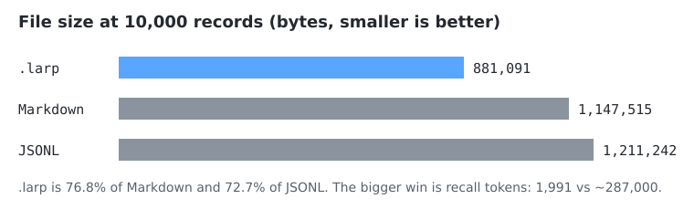

# Benchmarks — Phase 3

Method: `cargo run --release --example bench` — 10,000 generated memories
(facts, preferences, episodes; short texts, heavy template repetition).
Machine: this dev VM. Re-run to reproduce.

## Results

| Metric | Value |
|---|---|
| Records | 10,000 |
| .larp (v2, zstd) size | 1,043,732 bytes |
| Markdown dump size | 1,147,515 bytes |
| JSONL size | 1,211,242 bytes |
| .larp vs Markdown | **91.0%** |
| .larp vs JSONL | **86.2%** |
| Bulk write (10k records) | 89 ms |
| Search (avg, 10k records) | 0.85 ms |
| Recall (avg, 10k records) | 0.70 ms |
| Single append on 10k file | 64 ms |
| Recall at 2000-token budget | 181 records, 1991 tokens used |

## Regression gate

The Benchmarks workflow fails on regressions vs
[benchmark-baseline.txt](benchmark-baseline.txt), checked by
`.github/scripts/check-bench.py`: sizes and token counts +10%,
percentage points +2.0, latencies 3x (shared runners are noisy), and
the recall count must not drop. To update the baseline after an
intentional change, re-run `cargo run --release --example bench`,
replace the values in the baseline file, and say why in the commit
message.

## Honest reading

**The size target was missed.** The plan aimed for ≥50% smaller than
Markdown. Measured: only 9% smaller. Cause: records here are short
(~60–100 chars), so per-record framing (41 bytes of metadata + zstd frame
overhead per record) dominates, and per-record compression cannot exploit
repetition *across* records — which is where most of the redundancy lives.

**The token story is the real win.** The full 10,000-record Markdown file is
~287,000 tokens (bytes/4 estimate). Token-budget recall serves the 181
best memories in 1,991 tokens — **99.3% fewer tokens** than a full-file dump,
at sub-millisecond latency. That, not raw bytes, is what saves agent cost.

## Next optimizations (not yet implemented)

1. **Shared zstd dictionary** stored in the header, trained on record text —
   should compress short records far better than per-record frames alone.
2. **Block-compressed segments** (compress batches of records together) to
   exploit cross-record repetition.
3. **Faster appends**: single appends currently re-read the file to assign
   the next id (O(n) — 64 ms at 10k records). Cache the max id, or add a
   bulk-import path, before append latency matters at scale.
